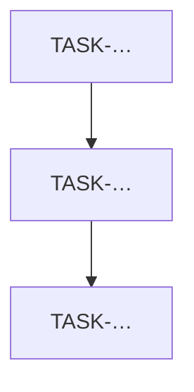

# Engineering remediation roadmap

| Field                   | Value |
| ----------------------- | ----- |
| Audit ID                |       |
| Generated from findings |       |

Priority: **P0** launch blockers · **P1** required before production · **P2** operational maturity · **P3** future enhancements.

## Task register

### TASK-XXX

| Field                            | Value                                             |
| -------------------------------- | ------------------------------------------------- |
| Task ID                          | TASK-XXX                                          |
| Related finding                  | FIND-XXX                                          |
| Priority                         | P0 \| P1 \| P2 \| P3                              |
| Module                           | e.g. `apps/graphql/services/pos_fiscalization.py` |
| Problem                          |                                                   |
| Business impact                  |                                                   |
| Proposed implementation          |                                                   |
| Dependencies                     | TASK-… \| none                                    |
| Estimated effort (engineer-days) |                                                   |
| Acceptance criteria              |                                                   |
| Suggested automated tests        |                                                   |

<!-- Duplicate TASK-XXX for each remediation item. Do not implement unless user requests. -->

## Dependency-aware sequence

1. …
2. …
3. …

## Minimum Viable Germany Launch Plan

Smallest practical engineering set for a **controlled** first commercial deployment in Germany.

| Order | Task ID | Why required for controlled launch | Effort (d) |
| ----- | ------- | ---------------------------------- | ---------: |
| 1     |         |                                    |            |
| 2     |         |                                    |            |
| 3     |         |                                    |            |

**Out of scope for MVGL (explicitly deferred):** …

**Residual accepted risks (must be listed for CONDITIONAL GO):** …

**External non-engineering gates still required:** TSE certification / tax advisor / DSFinV-K acceptance / Mitteilung process / legal review.
