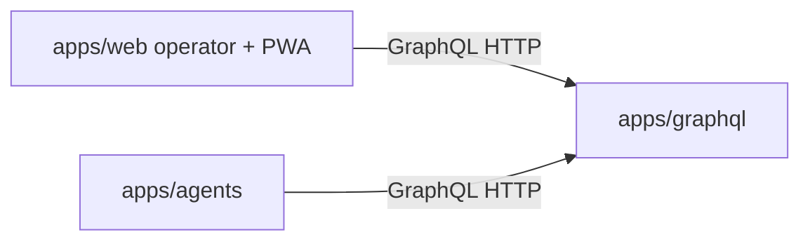

# Menuyukti: repository orientation

This skill is for **Cursor/agents** navigating the repo. The **product home** is chat-first (`/advisor`, `agentThreadId`) — see [`menuyukti-web`](../menuyukti-web/SKILL.md) and [`menuyukti-agents`](../menuyukti-agents/SKILL.md).

## Service map

| Area                    | Path              | Role                                                                                                                                                                                            |
| ----------------------- | ----------------- | ----------------------------------------------------------------------------------------------------------------------------------------------------------------------------------------------- |
| **Web**                 | `apps/web`        | Next.js: operator shell (chat `/advisor`, analytics + **native POS**, inventar, …) and **customer PWA** (Serwist). **GraphQL only** — no direct DB.                                             |
| **Mobile (deprecated)** | `apps/mobile-app` | Expo CRM client — **inactive**; kept in repo. Prefer **web PWA** for customer work. Still GraphQL/BFF only if touched.                                                                          |
| **GraphQL API**         | `apps/graphql`    | Strawberry schema, **SQLAlchemy persistence**, analytics, POS, inventory, CRM. **Single HTTP API** for web and agents (and legacy mobile BFF).                                                  |
| **LangGraph agents**    | `apps/agents`     | FastAPI, LangChain / LangGraph **streaming chat** (`general` \| `image_assistant` \| `inventar`) + holiday/nearby helpers. **Calls GraphQL over HTTP**; **does not** open database connections. |
| **Shared packages**     | `packages/*`      | Shared TypeScript libraries; Python: [`packages/menuyukti`](../../../packages/menuyukti) (analytics), optional legacy workspace packages per root config.                                       |

`apps/mobile-app` is deprecated/inactive and omitted from the active flow.

## Domain skills (go deeper)

| Skill                                                                            | When to open it                                                                                      |
| -------------------------------------------------------------------------------- | ---------------------------------------------------------------------------------------------------- |
| [`menuyukti-agents`](../menuyukti-agents/SKILL.md)                               | `apps/agents`: FastAPI, LangGraph chat (general + image_assistant + inventar), GraphQL clients.      |
| [`menuyukti-graphql`](../menuyukti-graphql/SKILL.md)                             | `apps/graphql`: Strawberry, Alembic, POS/fiscalization, inventory, CRM, resolvers for web/agents.    |
| [`menuyukti-web`](../menuyukti-web/SKILL.md)                                     | `apps/web`: Next.js, Clerk, next-intl, `/advisor`, PWA, native POS UI, GraphQL from the browser/BFF. |
| [`menuyukti-mobile`](../menuyukti-mobile/SKILL.md)                               | Legacy Expo app only — **deprecated / inactive**; prefer web PWA.                                    |
| [`menuyukti-analytics`](../menuyukti-analytics/SKILL.md)                         | `packages/menuyukti`: pandas pipelines, Instagram signals, GraphQL `transform` integration.          |
| [`menuyukti-germany-pos-readiness`](../menuyukti-germany-pos-readiness/SKILL.md) | Evidence-based Germany POS engineering readiness audits (fiscal, VAT, payments, GDPR, reliability).  |

## Cross-app flow: chat

1. User opens **`/advisor`** (thread = `agentThreadId`).
2. Web BFF **`/api/chat`** forwards the turn to agents **`POST /chat`** with `agent_thread_id` (+ optional `location_id`, `chat_mode`).
3. Agents ReAct graph may call **GraphQL** (location, charts, media) via `graphql_post`.
4. History loads via **`/api/chat/history`** ↔ agents **`GET /chat/history`**.

See [`menuyukti-agents`](../menuyukti-agents/SKILL.md) and [`menuyukti-web`](../menuyukti-web/SKILL.md). Cleanup history for the old campaign-pipeline model: [`packages/docs/menuyukti/remove-milestones.md`](../../../packages/docs/menuyukti/remove-milestones.md).

## Database ownership

- **Schema, migrations, and SQLAlchemy** live **only** in **`apps/graphql`**.
- **`apps/web`** and **`apps/agents`** must **not** add DB drivers, connection strings for app data, or migration scripts for product data. Same rule if anyone touches deprecated **`apps/mobile-app`**.
- Turbo may expose `db:*` scripts when the GraphQL package defines them; **ownership** stays in GraphQL — see `apps/graphql` README / Makefile.

## pnpm versus uv

| Use                   | Tool     | Scope                                                                                          |
| --------------------- | -------- | ---------------------------------------------------------------------------------------------- |
| **Node / TypeScript** | **pnpm** | Workspaces `apps/*`, `packages/*`; root scripts (`pnpm build`, `pnpm lint`, …). Node **>=20**. |
| **Python**            | **uv**   | Root `pyproject.toml` workspace; `uv sync`, `uv run`, `uv add` from repo root or app dirs.     |

**Do not** suggest `npm` or `yarn` for installs, or ad-hoc `pip install` as the default workflow.

## Canonical references

- [`.cursor/rules/project-overview.mdc`](../../../.cursor/rules/project-overview.mdc) — product context and layering.
- [`.cursor/rules/monorepo-conventions.mdc`](../../../.cursor/rules/monorepo-conventions.mdc) — pnpm, Turbo, uv, formatting.
- [`.agents/skills/turborepo/SKILL.md`](../turborepo/SKILL.md) — Turbo pipelines, caching, `--filter`.
- App READMEs: `apps/web`, `apps/graphql`, `apps/agents`, `apps/mobile-app`.

## Non-goals

- **Duplicating** full command matrices — link app READMEs / monorepo conventions instead.
- **Per-app implementation detail** — use the domain skills above.

## Progressive disclosure

If this file grows, split long reference material into `reference.md` in this folder.
