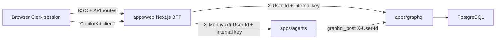

# Menuyukti platform architecture

Current system map after removal of the Expo CRM client and CRM/device-auth stack (TASK-15). Use this as the canonical product architecture overview.

## Agent infrastructure at a glance

Designed so the agent runtime and the product data plane stay separate — agents use tools over HTTP, not the database.

```text
Operator chat → Web BFF (stamps session identity)
  → LangGraph ReAct (apps/agents)
  → Tools → GraphQL (single persistence; agents have no app DB)
  → Generative UI (chosen charts) → brief / plan / next actions
```

| Concern             | Design                                                                                                                                                              |
| ------------------- | ------------------------------------------------------------------------------------------------------------------------------------------------------------------- |
| **Agent runtime**   | `apps/agents` — FastAPI + LangGraph ReAct, tool catalog, checkpointer, AG-UI adapter. Chat orchestration is **not** in GraphQL.                                     |
| **Data plane**      | `apps/graphql` — Strawberry + SQLAlchemy + Alembic; **only** place with product DB access and migrations.                                                           |
| **Analytics**       | `packages/menuyukti` — pure compute (pandas); invoked from GraphQL services, not persisted by agents.                                                               |
| **Tool boundary**   | Agents call GraphQL over HTTP (`graphql_post`). No direct Postgres from `apps/agents`.                                                                              |
| **Identity**        | Browser never supplies user id to agents/GraphQL. Web BFF stamps Clerk user + internal API key; agents forward that user id into tool/GraphQL calls via run config. |
| **Fail closed**     | Production GraphQL and agents require the internal API key; missing key → refuse privileged traffic.                                                                |
| **Durable threads** | LangGraph checkpoints on agents Postgres (`LANGGRAPH_CHECKPOINT_DATABASE_URL`); thread key `{clerkUserId}:agent:{agentThreadId}`.                                   |

Runtime detail (tool gating, chart catalog, CoAgent sync): [doc-9 Advisor agent runtime and AG-UI sync](../agents/doc-9%20-%20Advisor-agent-runtime-and-AG-UI-sync.md).

## Product focus

Menuyukti is a **chat-first** operator platform for restaurant marketing and operations. The home surface is **`/advisor`**. Operators also use analytics, digital-menu Order board, inventar, media, IG Studio, calendar, and staff tools.

**Customer-facing product** is the **web PWA** in `apps/web` (Serwist). There is no native mobile app in the monorepo.

There is **no** live campaign-workflow / milestone pipeline and **no** CRM loyalty / device-auth product surface.

## Services

| App             | Path           | Role                                                                                                          |
| --------------- | -------------- | ------------------------------------------------------------------------------------------------------------- |
| **Web**         | `apps/web`     | Next.js: operator shell + customer PWA. GraphQL via BFF only. Advisor chat via CopilotKit BFF → agents.       |
| **GraphQL API** | `apps/graphql` | Strawberry + SQLAlchemy + Alembic. **Single source of truth** for product data and migrations.                |
| **Agents**      | `apps/agents`  | FastAPI + LangGraph. Streaming chat ReAct agent; holiday/nearby helpers. Calls GraphQL over HTTP — **no DB**. |

Shared: `packages/ui` (design system), `packages/menuyukti` (pandas analytics), tooling packages. Orchestration: **pnpm** + Turbo (Node), **uv** (Python).



## Data and ownership

- **All product persistence** lives in `apps/graphql` (Alembic). Web and agents must not open app DB connections.
- Web uses `graphqlQuery` (`apps/web/lib/graphql/client.ts`) with Clerk `userId` as `X-User-Id`.
- Agents use `graphql_post` (`apps/agents/agents/graphql_base.py`) with the same user id from run config.
- Analytics math that is not persistence belongs in `packages/menuyukti` and is invoked from GraphQL services.

## Auth trust boundary

| Hop              | Identity                                  | Secret               |
| ---------------- | ----------------------------------------- | -------------------- |
| Human → Web      | Clerk session                             | Clerk keys           |
| Web → GraphQL    | `X-User-Id` (Clerk, server-set)           | `X-Internal-Api-Key` |
| Web → Agents     | `X-Menuyukti-User-Id` (Clerk, server-set) | Same internal key    |
| Agents → GraphQL | `X-User-Id` from configurable             | Same internal key    |

**Hard rule:** never trust a browser-supplied user id for agents or GraphQL. CopilotKit context headers are allowlisted and **exclude** identity (`apps/web/lib/chat/copilotkit-context-headers.ts`). The BFF stamps identity on the server-side `HttpAgent`.

Production GraphQL and agents fail closed when the internal API key is required and missing. See [doc-1 Chat advisor security overview](../security/doc-1%20-%20Chat-advisor-security-overview.md).

## Major product surfaces (web)

| Surface                         | Notes                                                                |
| ------------------------------- | -------------------------------------------------------------------- |
| `/advisor`                      | Chat home (rewrite to `app/(protected)/agent/`). CopilotKit + AG-UI. |
| Analytics / locations / reports | Operator analytics; sales reports and COGS tied into advisor rail.   |
| Digital menu Order board        | `/services/digital-menu/[locationId]/orders`                         |
| Inventar                        | Inventory UI; inventar chat mode via same advisor agent              |
| IG Studio / media / calendar    | Content tools; some helpers still use SSE `/api/chat`                |
| Customer PWA                    | `/home`, `/continue`, `/profile`, public `/m/[slug]` menus           |

## Agent placement

Chat orchestration is **not** in GraphQL. The ReAct graph, tools, checkpointer, and AG-UI adapter live in `apps/agents`. Runtime detail: [doc-9 Advisor agent runtime and AG-UI sync](../agents/doc-9%20-%20Advisor-agent-runtime-and-AG-UI-sync.md).

Conversation checkpoints use Postgres on the agents service (`LANGGRAPH_CHECKPOINT_DATABASE_URL`). Thread key: `{clerkUserId}:agent:{agentThreadId}`.

## Explicit non-goals

- Native Expo / CRM enroll / device JWT auth (removed).
- Milestone / campaign workflow containers (removed earlier).
- Direct browser → agents or browser → GraphQL with operator credentials.

## Related

- Root `README.md`, `.cursor/rules/project-overview.mdc`
- `.agents/skills/menuyukti-repo-orientation/SKILL.md`
- Migration history for CopilotKit cutover: [doc-7](../agents/doc-7%20-%20ChatKit-to-CopilotKit-migration-architecture.md) (historical; live path is CopilotKit-only)
